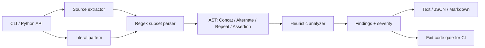

<div align="center">

# redos-lint

**Catch catastrophic regex backtracking before your CPU does.**

[](https://github.com/yazilimbaysoz-svg/redos-lint/actions/workflows/ci.yml)
[](https://www.python.org/)
[](https://pypi.org/)
[](https://semgrep.dev/)
[](LICENSE)
[](https://github.com/yazilimbaysoz-svg/redos-lint)

</div>

---

## The problem

A single regex such as `^(a+)+$` can turn a 30-character input into minutes of CPU time.
ReDoS (Regular Expression Denial of Service) vulnerabilities hide in validation code, route
matchers, log parsers and WAF rules — and most scanners either need a heavy runtime, a network
call, or a full language toolchain.

**redos-lint** is a small, fully offline static analyzer that finds ambiguous regex structures
before they reach production. It has **zero runtime dependencies**, runs on a laptop with 8 GB
of RAM, and exits non-zero so your CI fails fast.

## Türkçe özet

`redos-lint`, kaynak koddaki regex kalıplarını tarayıp **ReDoS** (catastrophic backtracking)
riskini CI sırasında yakalayan, tamamen yerel ve bağımlılıksız bir Python aracıdır. Gizli veri
göndermez, ağ kullanmaz, saniyeler içinde `file:line` bazlı rapor üretir.

## Features

- Detects nested quantifiers, nullable repeats, overlapping alternations, adjacent ambiguous
  quantifiers and backreferences inside repeats.
- Scans Python (`re`/`regex` calls) and JavaScript/TypeScript (regex literals, `RegExp(...)`).
- Text, JSON and Markdown output; `--fail-on {low,medium,high,critical,none}` severity gating.
- `# redos-lint: ignore` / `// redos-lint: ignore` inline suppression.
- No telemetry, no network, no regex execution on user input — pure structural analysis.
- Compact modular architecture, ~1 MB installed, Python 3.11+.

## Architecture



The parser intentionally implements only the constructs that matter for ambiguity analysis
(groups, classes, escapes, alternation and quantifiers). It never executes the pattern, so
scanning an untrusted repository cannot trigger the very bug it detects.

## Quick start

```bash
uv tool install redos-lint
redos-lint check '^(a+)+$'
```

From source:

```bash
git clone https://github.com/yazilimbaysoz-svg/redos-lint.git
cd redos-lint
uv venv
uv pip install -e '.[dev]'
uv run redos-lint scan . --fail-on high
```

## Real examples

```console
$ redos-lint check '^(a+)+$'
redos-lint: 1 finding(s) across 1 pattern(s)
  [CRITICAL] <literal>  nested-quantifier
      pattern: ^(a+)+$
      Unbounded repetition is ambiguous: the repeated expression contains another quantifier.
      fix: Bound the quantifier (for example {1,64}) or validate the maximum input length first.
```

```console
$ redos-lint check '(?>a+)+'
redos-lint: 0 finding(s) across 1 pattern(s)
  No risky patterns found.
```

```console
$ redos-lint scan ./src --format json --fail-on high
{
  "version": 1,
  "patterns_checked": 42,
  "counts": { "low": 0, "medium": 1, "high": 2, "critical": 0 },
  "findings": [
    {
      "pattern": "\\s+\\s+",
      "severity": "high",
      "code": "overlapping-quantifiers",
      "message": "Adjacent quantifiers can consume the same characters...",
      "suggestion": "Combine adjacent quantifiers into one bounded expression...",
      "source": "src/parser.py",
      "line": 87
    }
  ]
}
```

### Fixing a finding

| Risky | Safer |
| :--- | :--- |
| `^(a+)+$` | `^a{1,64}$` |
| `^(\w+\s?)*$` | `^[\w ]{1,128}$` |
| `(a\|aa)+` | `(?:a\|aa){1,32}` or an atomic group |
| `\s+\s+` | `\s+` |
| `(.*)*foo` | `[^\n]{0,200}foo` |

## Python API

```python
from redos_lint import Severity, analyze_pattern, scan_sources
from pathlib import Path

for finding in analyze_pattern(r"^(a+)+$"):
    print(finding.severity.label(), finding.code, finding.suggestion)

report = scan_sources((Path("src"), Path("web")), excludes=("*.min.js",))
blocking = report.filtered(Severity.HIGH)
if blocking:
    raise SystemExit(f"{len(blocking)} risky regex(es) found")
```

## CI integration

```yaml
- uses: actions/checkout@v4
- uses: astral-sh/setup-uv@v5
- run: uv tool install redos-lint
- run: redos-lint scan src web --fail-on high
```

## Rule catalog

| Code | Severity | Meaning |
| :--- | :--- | :--- |
| `nested-quantifier` | CRITICAL / HIGH | A repeated expression contains another quantifier. |
| `overlapping-alternation` | CRITICAL / MEDIUM | Branches can match the same input. |
| `overlapping-quantifiers` | HIGH / MEDIUM | Adjacent quantifiers compete for the same characters. |
| `nested-quantifier` | HIGH | Repeated expression is nullable or contains a backreference. |
| `parse-error` | LOW | Unsupported syntax; manual review advised. |

## Suppression

Add `redos-lint: ignore` on the same line as the regex when a risk is consciously accepted:

```python
pattern = re.compile("(a+)+")  # redos-lint: ignore - bounded by upstream schema
```

## Limitations

- This is a structural heuristic, not a formal decidability proof; it can produce false
  positives and may miss engine-specific edge cases.
- It reports risk, not measured runtime. For adversarial input testing, combine with fuzzing.
- Extraction covers Python and JavaScript/TypeScript string literals; dynamically assembled
  patterns are not resolved.

## Development

```bash
uv sync --extra dev
uv run pytest --cov=redos_lint
uv run ruff check .
uv run ruff format --check .
uv run --with semgrep semgrep scan --config semgrep-rules.yml .
```

## License

[MIT](LICENSE) © 2026 Muslum Baysoz — BAYSOZ LABS / Open Source.
